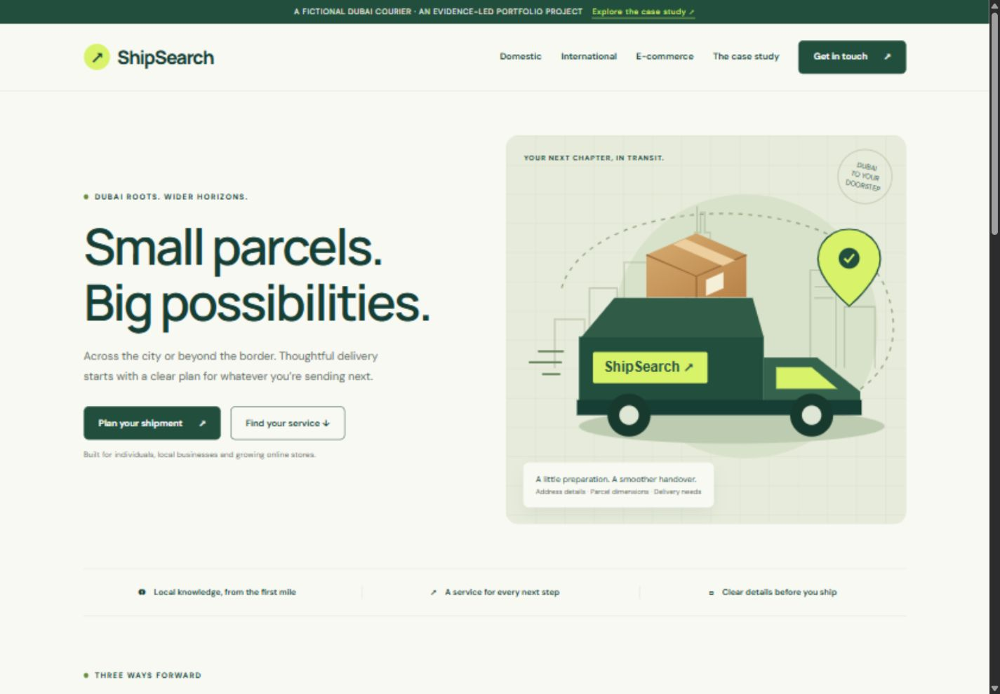
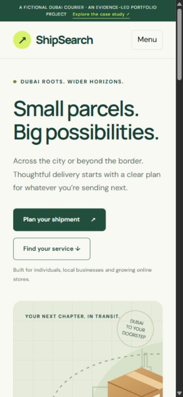
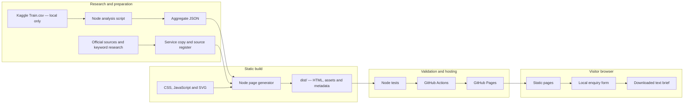

<div align="center">

# ShipSearch ↗

### Small parcels. Big possibilities.

A Dubai courier concept brought to life through thoughtful content,<br>
a working frontend, and research you can inspect.

[](https://github.com/vaishnavibnsall/shipsearch-logistics-seo/actions/workflows/ci.yml)
[](https://github.com/vaishnavibnsall/shipsearch-logistics-seo/actions/workflows/pages.yml)


**[Explore the website](https://vaishnavibnsall.github.io/shipsearch-logistics-seo/)** · **[Read the case study](https://vaishnavibnsall.github.io/shipsearch-logistics-seo/case-study/)** · **[View the audit](docs/SEO-AUDIT.md)**

</div>



> **Portfolio project · fictional brand.** ShipSearch demonstrates frontend engineering, service content and SEO implementation. It is not an operating courier. The enquiry tool generates a local brief; it does not book or send a shipment.

## At a glance

| Experience | Research | Engineering |
| :--- | :--- | :--- |
| **7** complete static pages | **10,999** external shipping records | **0** third-party build/runtime packages |
| **3** focused service journeys | **12** keyword hypotheses | **5** automated checks |
| Responsive UI and enquiry export | **3** real competitors reviewed | GitHub Actions → GitHub Pages |

<details>
<summary><strong>Navigate this project</strong></summary>

[Overview](#overview-and-problem) · [Features](#key-features) · [Screenshots](#screenshots) · [Stack](#technology-stack) · [Architecture](#system-architecture) · [Data schema](#database-schema-and-data-contracts) · [API](#api-documentation) · [Installation](#local-installation) · [Environment](#environment-configuration) · [Dataset](#dataset-details) · [Testing](#testing) · [CI/CD](#cicd) · [Deployment](#deployment) · [Product documentation](#product-management-documentation) · [Limitations](#known-limitations) · [Roadmap](#future-roadmap) · [License](#license)

</details>

## Overview and problem

Shipping customers need to know which service fits their parcel, what information affects a quote, and what to confirm before a handover. Online stores also need to consider recurring collections, cash on delivery and returns.

ShipSearch addresses those tasks through three focused service pages and an enquiry preparation tool. A public case study explains the research, content decisions and technical SEO implementation behind the experience.

**Project goal:** make a delivery enquiry easier to prepare while producing an inspectable portfolio project. No conversion, search ranking or commercial performance improvement has been measured.

## Key features

| Area | Implemented behavior |
| :--- | :--- |
| Service discovery | Domestic, international and e-commerce delivery pages with preparation guidance, FAQs and related links. |
| Enquiry builder | Native input validation, service preselection, actual / volumetric weight comparison and `.txt` brief export. |
| Browser privacy | No enquiry submission or persistence; editing inputs clears an outdated brief. |
| Technical SEO | Unique titles, descriptions and H1s; canonicals; sitemap; robots; Open Graph; WebPage JSON-LD; descriptive links and image text. |
| Accessible foundations | Skip link, labelled fields, keyboard focus, native FAQ disclosures, mobile menu and reduced-motion support. |
| Research | Keyword intent map, official-source competitor comparison and a controlled before/after audit. |
| Reproducible data | Kaggle aggregate analysis, exact source checksum and explicit interpretation limits. |

## Screenshots

The desktop image above and phone image below are real browser captures from local QA, not design mockups.

<div align="center">
  
</div>

See the [QA record](docs/QA.md) for viewport sizes and tested interactions.

## Technology stack

| Layer | Technology | Purpose |
| :--- | :--- | :--- |
| Frontend | HTML5, CSS, vanilla JavaScript | Complete static content with lightweight browser interactions. |
| Build | Node.js 22+, ES modules | Generates pages, metadata, sitemap and downloadable data. |
| Visuals | Original SVG, Google Fonts | Local illustration; DM Sans / Manrope with system fallbacks. |
| Data | CSV → Node aggregation → JSON | Reproducible descriptive analysis. |
| Tests | `node:test`, strict assertions | Generated-output validation without a framework. |
| Delivery | GitHub Actions, GitHub Pages | Automated checks, artifact upload and public hosting. |

No application backend, database, authentication or courier integration is implemented.

## System architecture



HTML contains service content before JavaScript executes. Browser JavaScript enhances navigation and builds an enquiry brief using a `Blob`. Form values never enter the build pipeline or a server.

```text
shipsearch/
├── .github/workflows/     # Validation and deployment
├── data/                 # Aggregates and generated inventories
├── docs/                 # Research, architecture, product brief and QA
├── scripts/              # Build, analysis and development server
├── src/                  # Content, CSS, browser JS and SVG
├── tests/                # Generated-output checks
├── .env.example          # Public build configuration
└── dist/                 # Generated website; ignored by Git
```

## Database schema and data contracts

**There is no database.** The project uses explicit file contracts rather than persistent business tables:

| File | Main fields | Role |
| :--- | :--- | :--- |
| `data/shipping-summary.json` | `source`, `retrieved`, `sha256`, `rows`, `late`, `onTime`, `latePercent`, `averageSupportCalls`, `byMode[]`, `limitations` | External dataset aggregates. |
| `data/keyword-map.csv` | `keyword`, `intent`, `destination`, `priority`, `rationale` | Qualitative content plan generated from `src/content.mjs`. |
| `data/page-manifest.json` | `path`, `title`, `description`, `noindex` | Generated page inventory inspected by tests. |

Enquiry fields exist temporarily in browser memory. There are no customer records, cookies or local storage. [Architecture and data contracts](docs/ARCHITECTURE.md) documents field types and validation boundaries.

## API documentation

**No REST API or enquiry endpoint exists.** These are static resources. Paths below are relative to the deployed site root, `/shipsearch-logistics-seo/` on GitHub Pages.

| Method | Resource | Response |
| :--- | :--- | :--- |
| `GET` | `/`, `/domestic-delivery/`, `/international-shipping/`, `/e-commerce-delivery/` | Complete service HTML. |
| `GET` | `/case-study/`, `/enquiry/`, `/privacy/` | Research, enquiry interface and privacy HTML. |
| `GET` | `/data/shipping-summary.json` | Aggregate JSON with provenance. |
| `GET` | `/data/keyword-map.csv` | Downloadable keyword map. |
| `GET` | `/sitemap.xml`, `/robots.txt` | Search discovery files. |

`/enquiry/?service=international-shipping` preselects a service. The other supported values are `domestic-delivery` and `e-commerce-delivery`; unknown values leave the default selection unchanged.

```sh
curl https://vaishnavibnsall.github.io/shipsearch-logistics-seo/data/shipping-summary.json
```

No credentials are needed. See the [resource reference](docs/API.md) for response examples, error behavior and the local form contract.

## Local installation

**Prerequisites:** Git and Node.js 22+. No package installation or API key is required.

```sh
git clone https://github.com/vaishnavibnsall/shipsearch-logistics-seo.git
cd shipsearch-logistics-seo
npm run build
npm test
npm run dev
```

Open **http://127.0.0.1:4173**. Stop with `Ctrl+C`. Edit source files and rebuild to refresh the output; there is no hot reload. The server binds to loopback and is for development only.

| Command | Purpose |
| :--- | :--- |
| `npm run build` | Generate pages, assets and discovery files. |
| `npm run dev` | Serve the existing `dist/` directory on port 4173. |
| `npm test` | Inspect built output; build first. |
| `npm run analyze` | Recalculate aggregates from `data/raw/Train.csv`; download the input first. |

## Environment configuration

The tracked [`.env.example`](.env.example) contains public build settings only. No application secrets are required. Scripts **do not automatically load `.env` files**.

| Variable | Default | Format |
| :--- | :--- | :--- |
| `SITE_URL` | Private Sites preview origin | HTTPS origin, without trailing slash or path; controls absolute metadata. |
| `BASE_PATH` | Empty | Empty for root hosting, or one `/segment`, e.g. `/shipsearch-logistics-seo`. |

To reproduce the public Pages build using the example file:

```sh
node --env-file=.env.example scripts/build.mjs
```

To configure a custom root-hosted site in PowerShell:

```powershell
$env:SITE_URL = 'https://your-domain.example'
$env:BASE_PATH = ''
npm run build
```

For ordinary local preview and the current tests, leave `BASE_PATH` unset or empty. Tests expect root-relative files. CI validates a root build, then rebuilds the deployment artifact with the Pages origin and base path. Local `.env` files remain ignored; only `.env.example` is tracked.

## Dataset details

**Source:** [E-Commerce Shipping Data by Prachi Gopalani on Kaggle](https://www.kaggle.com/datasets/prachi13/customer-analytics), retrieved 30 October 2026.

| Property | Detail |
| :--- | :--- |
| Input | `Train.csv`: 10,999 rows and 12 columns. |
| Fields used | Shipment mode, customer care calls and `Reached.on.Time_Y.N`. |
| Label definition | Publisher defines **1 as NOT on time**, 0 as on time. |
| Outputs | Counts, late-labelled share, mean support calls and mode breakdowns. |
| Reproduction | Input checksum and counts in `data/shipping-summary.json`. |
| Redistribution | Raw records excluded from Git; only aggregates are committed. |

Download the source ZIP from Kaggle, extract `Train.csv` into `data/raw/`, then run:

```sh
npm run analyze
npm run build
npm test
```

The committed aggregates allow normal builds without downloading Kaggle data. The dataset has unspecified geography and sampling. Its results are **not UAE benchmarks, ShipSearch KPIs, causal findings or model accuracy claims**. Keyword priorities have no measured volume, CPC or difficulty. Read [data provenance and methodology](docs/DATA.md) before interpreting results.

## Testing

```sh
npm run build
npm test
```

Five automated checks cover unique metadata / H1 / JSON-LD, local links and fragments, homepage image descriptions and dimensions, sitemap / noindex consistency, and aggregate data reconciliation.

Browser QA covers responsive layouts, navigation, service preselection, weight calculation, brief generation, download and stale-result clearing. See [verification evidence](docs/QA.md). No full accessibility certification, measured Lighthouse score or search ranking validation is claimed.

## CI/CD

| Workflow | Trigger | Pipeline |
| :--- | :--- | :--- |
| [Build and SEO checks](.github/workflows/ci.yml) | Push and pull request | Checkout → Node 22 → build → tests. |
| [Deploy portfolio](.github/workflows/pages.yml) | Push to `main` or manual dispatch | Root build → tests → Pages rebuild → artifact upload → deployment. |

Validation uses read-only repository permissions. Pages deployment uses GitHub’s short-lived Actions identity with `pages: write` and `id-token: write`; no personal access token is stored in the repository. A concurrency group cancels an older in-flight deployment when a newer run starts. The `github-pages` environment records the deployed URL.

## Deployment

### GitHub Pages

The public site is **https://vaishnavibnsall.github.io/shipsearch-logistics-seo/**. Repository Pages settings use **GitHub Actions** as the source. Push to `main` to deploy.

For a fork, update `SITE_URL` and `BASE_PATH` in `.github/workflows/pages.yml`, plus README links and `.env.example`. A custom domain at `/` needs an empty base path.

### Other static hosts

Set the final HTTPS origin and base path, build, and upload the contents of `dist/`. The host must support directory index files. Configure its error handling to use `404.html` where supported. Do not deploy the development server as a production backend.

A separate [owner-private Sites preview](https://shipsearch-dubai-portfolio.quirkyskink512.chatgpt.site) uses `.openai/hosting.json`. Its access control prevents public search crawling. The Pages deployment sets its own public canonical URLs through CI.

## Product management documentation

| Document | Contents |
| :--- | :--- |
| [Product brief and backlog](docs/PRODUCT.md) | Users, scope, stories, acceptance criteria, risks and proposed metrics. |
| [Architecture and contracts](docs/ARCHITECTURE.md) | Module boundaries, data schema and tradeoffs. |
| [Resource reference](docs/API.md) | Static routes, downloads and enquiry behavior. |
| [Data methodology](docs/DATA.md) | Provenance, reproduction and limitations. |
| [SEO audit](docs/SEO-AUDIT.md) | Controlled baseline, fixes and measurement plan. |
| [QA record](docs/QA.md) | Checks, browser evidence and verification limits. |
| [Portfolio walkthrough](docs/PORTFOLIO.md) | Resume bullet, demo sequence and discussion points. |

## Known limitations

- Fictional company: no bookings, live rates, tracking, payments, coverage promises or courier integrations.
- Enquiries are local drafts with no lead database or notification backend.
- Dataset sampling and geography are unspecified; no Dubai performance inference is justified.
- Keyword mapping is qualitative; organic traffic and conversion outcomes are unmeasured.
- Google Fonts makes external requests; system fonts provide a fallback.
- The CSV parser is tailored to the source’s simple unquoted format, not arbitrary CSV.
- Tests assume root hosting; production base-path links are additionally checked through deployment QA.
- Local missing routes return a plain 404; production error handling depends on the host.

## Future roadmap

Proposed next steps; these are not implemented capabilities or delivery commitments.

| Priority | Next step | Completion evidence |
| :--- | :--- | :--- |
| P1 | Automate enquiry and responsive browser tests | CI checks calculations, downloads, service selection and mobile menu. |
| P1 | Validate copy with target users | Recorded task findings and content revisions. |
| P2 | Validate keyword demand | Dated Keyword Planner / Search Console evidence for a real launch. |
| P2 | Add a real enquiry backend after business validation | Consent-aware submission, server validation and retention policy. |
| P2 | Audit accessibility and performance | Documented findings, fixes and measured results. |
| P3 | Evaluate Arabic localization | Reviewed Arabic copy and tested RTL layouts. |
| P3 | Explore courier integrations | Provider agreement, sandbox integration and failure-handling tests. |

## License

Original project code, prose and illustration are licensed under the **[MIT License](LICENSE)**, as confirmed by the project owner. Third-party datasets, fonts, trademarks and external content retain their own terms and are excluded from this license.

---

<div align="center">

**From Dubai. With a clear direction.**<br>
[Website](https://vaishnavibnsall.github.io/shipsearch-logistics-seo/) · [Case study](https://vaishnavibnsall.github.io/shipsearch-logistics-seo/case-study/) · [Source](https://github.com/vaishnavibnsall/shipsearch-logistics-seo)

</div>
